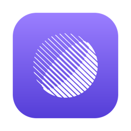
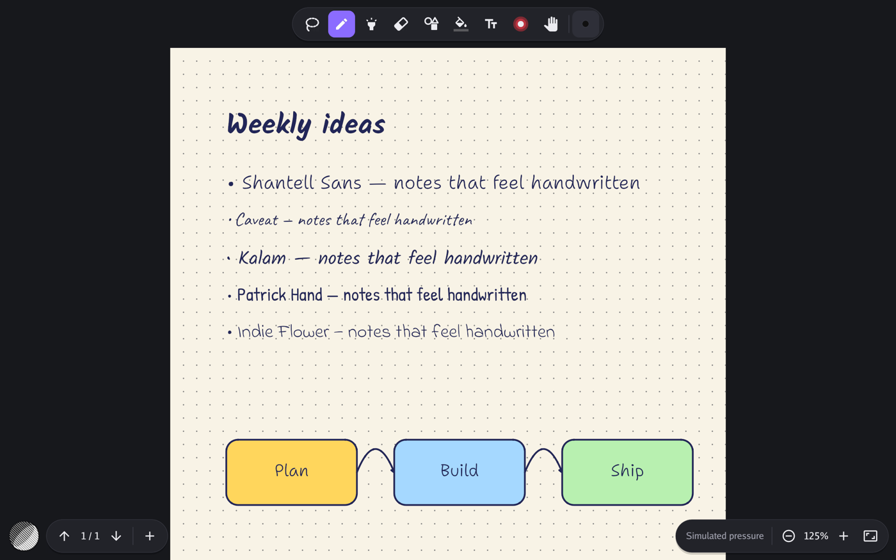
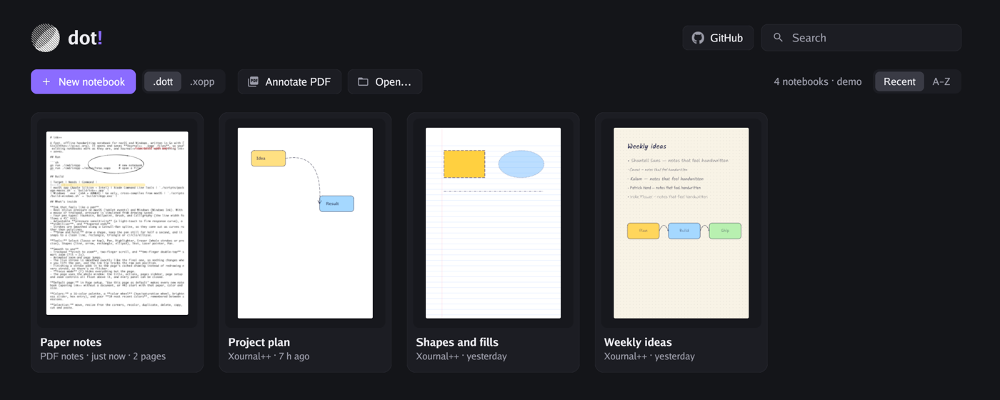
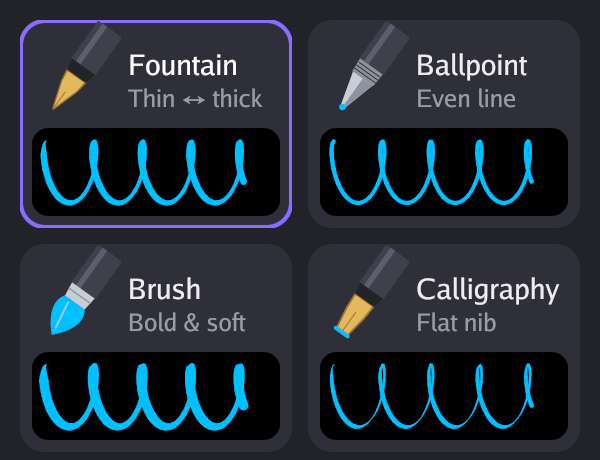
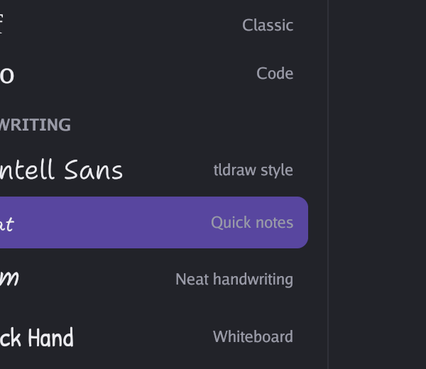

<p align="center">
  
</p>

<h1 align="center">dot!</h1>

<p align="center">
  <b>A fast, modern handwriting notebook. Offline, private, and friendly with Xournal++.</b><br>
  Write with a pen, sketch diagrams, annotate PDFs, and keep everything as files you own.
</p>

<p align="center">
  
  
  
  
  
</p>

<p align="center">
  <a href="https://dot-docs-brown.vercel.app/"><b>🌐 Website</b></a> &nbsp;·&nbsp;
  <a href="https://github.com/anikchand461/dot/releases/latest"><b>⬇️ Download</b></a> &nbsp;·&nbsp;
  <a href="#dot-vs-xournal">⚖️ vs Xournal++</a>
</p>

<p align="center">
  
</p>

---

## Why dot!?

I take my notes in **Xournal++**. It's a great, honest, open-source app: it handles a pen well, annotates PDFs, and its `.xopp` files are open. But day to day it felt dated:

- a toolbar full of small icons and menus, where simple things take several clicks;
- no way to fill a shape, bend an arrow, or type inside a box the way Excalidraw and tldraw allow;
- no cropping a pasted screenshot on the page, and no handwriting fonts built in;
- no home page: you find notes through a file dialog or the recent-files menu.

**dot! keeps what makes Xournal++ good** (offline, pen pressure, PDF annotation, open files) **and rebuilds the experience** around a clean full-screen page, a single floating tool dock, and a Home page that shows all your notebooks.

It reads and writes Xournal++ files, so you can switch back and forth: nothing is locked in.

## Highlights

|  |  |
|---|---|
| ✍️ **Ink that feels like a pen** | Real stylus pressure (macOS, Windows), four pen types (fountain, ballpoint, brush, calligraphy), adjustable sensitivity, stabiliser and tapered ends. Strokes are smoothed into curves *while* you write. |
| 🔷 **Diagrams, Excalidraw-style** | 11 shapes, fills in any color, dashed/dotted lines, bendable arrows, and text typed *inside* boxes. Draw a rough shape and hold still: it snaps to a clean one. |
| 🔤 **Handwriting fonts** | Shantell Sans (tldraw's font), Caveat, Kalam, Patrick Hand and Indie Flower, plus Sans/Serif/Mono, chosen from a live-preview dropdown. Embedded in exported PDFs. |
| 📄 **Annotate any PDF** | Write on lecture slides or papers. The export keeps the original pages untouched, so text stays selectable, with your ink drawn on top. |
| 🖼️ **Paste & crop** | ⌘V a screenshot or image, then resize and crop it on the page. Use any picture as a page background. |
| 🏠 **Home** | All your notebooks as cards with live previews, plus search, rename in place, and move to Trash. |
| 🪟 **Many windows** | Each window has its own notebook, undo history and tools (Shift ⌘N). |
| 🔒 **Offline & private** | No account, no cloud, no telemetry. One app file, notebooks saved where you choose, autosave every 20 s. |

<p align="center">
  
</p>

<p align="center">
  
  &nbsp;
  
</p>

## dot! vs Xournal++

### Performance (measured)

Both apps were run through the **same automated workload** on the same Mac (Apple Silicon): a **58-page notebook with 17,464 handwritten strokes**, with continuous drawing, fast scrolling through every page, zooming, and erasing, plus idle periods before and after.

| | Xournal++ 1.3 | **dot!** | |
|---|---:|---:|---|
| Open the 17 MB notebook | 3.5 s | **1.1 s** | 3× faster |
| CPU when idle | 3.0 % | **0.0 %** | |
| CPU while scrolling | 75 % | **40 %** | |
| CPU while zooming | 84 % | **65 %** | while zooming *further* (10–800 %) |
| CPU while erasing | 43 % | **17 %** | |
| CPU while drawing | **19 %** | 27 % | dot! smooths every stroke live |
| **Average CPU under load** | 54 % | **37 %** | ~30 % less |
| Memory, idle | **147 MB** | 202 MB | |
| Memory, peak | **335 MB** | 549 MB | |

**In short:** dot! uses noticeably **less CPU**, which matters for battery and heat, and opens large notebooks much faster. Xournal++ uses **less RAM**, because dot! keeps visible pages ready on the GPU so scrolling and zooming stay cheap. Typical frame times in dot! are ~4–7 ms (60–120 fps headroom).

<sub>Method: synthetic mouse input drove both apps; CPU and memory were sampled with <code>ps</code> twice a second. Results vary a little between runs, and Windows/Linux have not been benchmarked yet.</sub>

### Features

| | Xournal++ | dot! |
|---|:---:|:---:|
| Pen pressure | ✅ | ✅ (with pressure-curve, stabiliser and taper settings) |
| PDF annotation & export | ✅ | ✅ (original pages kept, text stays selectable) |
| Opens/saves `.xopp` | ✅ | ✅ |
| Self-contained notebook file (images, PDF and preview inside) | – | ✅ `.dott` |
| Filled shapes in any color | Outline color only | ✅ |
| Bendable arrows, text inside shapes | – | ✅ |
| Shape snapping (draw & hold) | ✅ ruler/recognizer | ✅ |
| Handwriting fonts | System fonts only | ✅ 5 bundled |
| Paste screenshots, crop images | Paste & insert | ✅ paste & crop |
| Home page with previews, search, rename, Trash | – | ✅ |
| Picture as page background | Image backgrounds | ✅ with soften & default |
| Layers panel | ✅ | not yet |
| LaTeX formulas, audio recording, Lua plugins | ✅ | – |

Xournal++ is still the better choice if you rely on layers, LaTeX, audio notes or plugins.

## Install & run

### Download

Get the latest version from the **[website](https://dot-docs-brown.vercel.app/#download)** or the **[Releases page](https://github.com/anikchand461/dot/releases/latest)**:

| System | File |
|---|---|
| macOS · Apple Silicon (M1–M4) | [`dot-macos-apple-silicon.dmg`](https://github.com/anikchand461/dot/releases/latest/download/dot-macos-apple-silicon.dmg) |
| macOS · Intel | [`dot-macos-intel.dmg`](https://github.com/anikchand461/dot/releases/latest/download/dot-macos-intel.dmg) |
| Windows · x64 | [`dot.exe`](https://github.com/anikchand461/dot/releases/latest/download/dot.exe) |
| Windows · ARM64 | [`dot-arm64.exe`](https://github.com/anikchand461/dot/releases/latest/download/dot-arm64.exe) |
| Linux · x64 | [`dot-linux-amd64.tar.gz`](https://github.com/anikchand461/dot/releases/latest/download/dot-linux-amd64.tar.gz) |
| Linux · ARM64 | [`dot-linux-arm64.tar.gz`](https://github.com/anikchand461/dot/releases/latest/download/dot-linux-arm64.tar.gz) |

- **macOS:** open the `.dmg` and drag dot! to Applications. The app isn't notarized by Apple yet, so if macOS says it can't be opened, run `xattr -dr com.apple.quarantine /Applications/dot.app` once.
- **Windows:** just run the `.exe`. If SmartScreen appears, click *More info → Run anyway*.
- **Linux:** unpack the tarball and run `./install.sh`.

### Build it yourself

dot! runs on **macOS, Windows and Linux**.

| Platform | Command | Result |
|---|---|---|
| macOS · Apple Silicon | `./scripts/package-macos.sh arm64` | `build/macos-apple-silicon/dot.app` + `build/dot-macos-apple-silicon.dmg` |
| macOS · Intel | `./scripts/package-macos.sh amd64` | `build/macos-intel/dot.app` + `build/dot-macos-intel.dmg` |
| Windows · x64 / ARM64 | `./scripts/build-windows.sh` | `build/dot.exe`, `build/dot-arm64.exe` |
| Linux · x64 / ARM64 (on Linux) | `./scripts/build-linux.sh` | `build/dot-linux-<arch>.tar.gz` |
| Linux, from macOS/Windows | `./scripts/build-linux-docker.sh` | same, built in Docker |

Requirements:
- [Go 1.26+](https://go.dev/dl/).
- **macOS 12+:** Xcode Command Line Tools (`xcode-select --install`).
- **Windows:** nothing else; it cross-compiles from any OS.
- **Linux:** a C compiler and the window-system headers listed at the top of `scripts/build-linux.sh`.

On Linux, unpack the tarball and run `./install.sh`. It installs for the current user (no root): the `dot` command, an app-menu entry, icons, and the `.dott`/`.xopp` file types. Pasting images uses `wl-paste` (Wayland) or `xclip` (X11).

### Run from source

```sh
go run ./cmd/dot                        # opens Home
go run ./cmd/dot ~/notes/lecture.xopp   # opens a notebook (also .dott or .pdf)
```

## Using dot!

| Key | Action |
|---|---|
| **V P H E S B T L G** | Select · Pen · Highlighter · Eraser · Shapes · Fill · Text · Laser · Pan |
| **Space** (hold) | Pan with any tool |
| **[ ]** | Thinner / thicker |
| **⌘Z / ⇧⌘Z** | Undo / redo |
| **⌘C ⌘X ⌘V ⌘D** | Copy · cut · paste (ink, images or text) · duplicate |
| **⌘S / ⇧⌘S / ⌘O / ⌘N** | Save · save as · open · new notebook |
| **⇧⌘N** | New window |
| **⌘E** | Export PDF |
| **⌘ + scroll, pinch** | Zoom; two-finger double-tap = smart zoom |
| **F** | Focus mode |
| **?** | All shortcuts |

On Windows and Linux use **Ctrl** instead of ⌘.

A few habits that help:
- **Draw and hold** at the end of a stroke to snap it into a clean line, rectangle, triangle or circle.
- **Double-click a shape** to type a label inside it.
- **Select an arrow** and drag its middle dot to bend it.
- **Scroll past the last page** to add a new one.
- **Page setup** (top-right, on hover) lets you choose paper, colors, size and a background image, and **"Use this page as default"** for new notebooks.

### Files

| Format | What it is |
|---|---|
| **`.dott`** | dot!'s own notebook: one self-contained file (zip) with the notes, background images, the annotated PDF and a preview. The default for new notebooks. |
| **`.xopp`** | The Xournal++ format, read and written compatibly. Choose it on Home if you go back and forth with Xournal++. |
| `.pdf` | Open to annotate; ⌘E exports an annotated PDF. |

Notebooks are saved in your **save folder** (`~/Documents/dot` by default; change it from the logo menu → Save folder). Older `.ink` files from before the rename still open.

## How it's built

dot! is written in **Go** with **[Gio](https://gioui.org)**, an immediate-mode GUI toolkit that draws everything on the GPU. There's no web view and no Electron; each platform gets one native executable.

```
cmd/dot/             entry point (one window per notebook)
internal/ink/        stroke engine: pressure curve, pen styles, smoothing, taper, shape recognition
internal/input/      stylus pressure (macOS NSEvent, Windows Ink) and trackpad gestures, with a speed-based fallback
internal/document/   notebook model, .xopp / .dott read & write, undo/redo
internal/canvas/     pages, zoom/pan, tools, GPU rendering (chunked, culled, cached page pictures)
internal/export/     vector PDF writer (embedded fonts), annotated-PDF export, PNG
internal/pdf/        PDFium (Chrome's PDF engine) via WebAssembly: no C libraries needed
internal/ui/         Home, tool dock, panels, menus, shortcuts
internal/clipboard/  system clipboard images/text (macOS, Windows, Linux)
internal/trash/      move to Trash / Recycle Bin
assets/              logo.png (source) + generated icons  ·  ./scripts/make-icons.sh
packaging/linux/     .desktop entry, MIME types, install.sh
```

Design notes:
- **Smooth ink:**
  - The live stroke goes through the same spline smoothing as the final stroke, so nothing jumps when you lift the pen.
  - Pressure comes from native OS events, matched to Gio's pointer events by timestamp.
- **Fast rendering:**
  - Each page's ink is recorded in small chunks: an edit re-records only its chunk, and chunks off screen aren't drawn.
  - When zoomed far out, pages are drawn from cached pictures.
- **Never blocks:** saving, opening and PDF rendering run in the background. Autosave writes a snapshot, so drawing never pauses.
- **Fonts:** the handwriting fonts are bundled under the SIL Open Font License (see `internal/canvas/fonts/`).

Run the tests with `go test ./...`. They cover ink, shape recognition, file round trips (including real Xournal++ notebooks), PDF export and UI snapshots.

## Roadmap

- Layers panel
- Infinite canvas
- Opening a notebook by double-clicking it in Finder while dot! is running
- Lower memory use: cache fewer off-screen pages, run memory cleanup more often
- Benchmarks on Windows and Linux

---

<p align="center"><sub>Made with a pen, a lot of ink, and Go.</sub></p>
